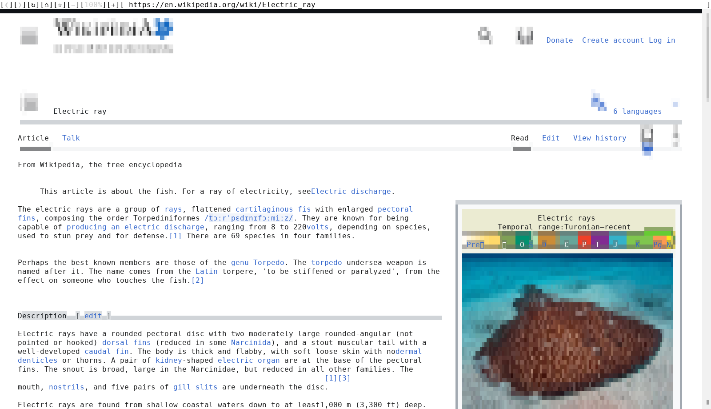
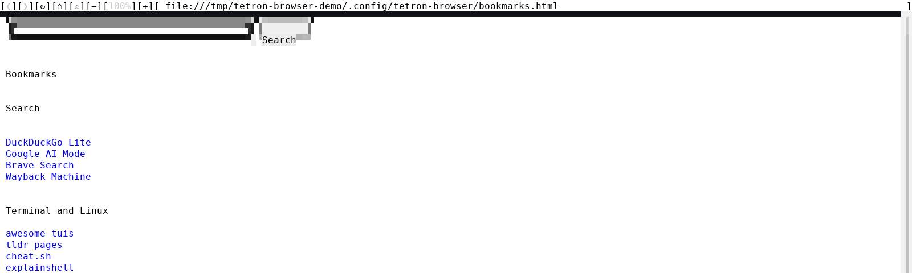

# tetron-browser

**Website: [tetronos.github.io/tetron-browser](https://tetronos.github.io/tetron-browser/)**

**The real web, in a terminal.** Chromium renders the page; tetron-browser draws it as truecolor blocks with a mouse, in any terminal, over ssh, or on a bare Linux console with no X11 or Wayland.

<p align="center">
  
</p>

It is the web browser of [TetronOS](https://github.com/tetronos/tetron-os) and of the [tetron-wm](https://github.com/tetronos/tetron-wm) terminal desktop. The command is `tetron-browser`, or `twww` for short.

## Why use it

- **Pages that work.** It is Chromium underneath: JavaScript, cookies and logins, web apps, CSS layout, images and video. Text browsers such as lynx and w3m can not run the scripts most sites need.
- **Where there is no browser.** On a server over ssh, on a Linux console with no window server, inside tmux or tetron-wm.
- **Point and click.** Click links and buttons, scroll with the wheel, right-click for a menu. Keyboard input goes to the page.
- **Tabs that cost nothing.** Only the tab you look at is a live page; background tabs keep their address, title and scroll position, and reopen on the next start.

## Install

On Debian, Ubuntu and their derivatives (amd64), from the [tetronos apt repository](https://tetronos.github.io/apt/), so `apt upgrade` keeps it current:

```sh
sudo curl -fsSLo /usr/share/keyrings/tetronos-archive-keyring.gpg https://tetronos.github.io/apt/tetronos-archive-keyring.gpg
sudo curl -fsSLo /etc/apt/sources.list.d/tetronos.sources https://tetronos.github.io/apt/tetronos.sources
sudo apt update && sudo apt install tetron-browser
```

**On TetronOS it is already there:** tetron-browser is the web browser of [TetronOS](https://github.com/tetronos/tetron-os). Every TetronOS desktop installs it (the `tetronos-desktop` package depends on it), and the [tetron-wm](https://tetronos.github.io/tetron-wm/) desktop opens web pages in it. On other systems, the [tetron-wm suite installer](https://tetronos.github.io/tetron-wm/) adds it with its essentials collection.

Other ways, from the [latest release](https://github.com/tetronos/tetron-browser/releases/latest):

- **The `.deb` alone:** download `tetron-browser_<version>-1_amd64.deb`, check it against its `.sha256`, then `sudo apt install ./tetron-browser_<version>-1_amd64.deb`. It is not updated by `apt upgrade`.
- **Any other Linux distribution:** `tetron-browser.linux-amd64.zip` (with `.sha256`). Unpack it and run `tetron-browser` in that folder. It needs glibc 2.34 or newer and the libraries Chromium uses (nss, nspr, expat, alsa).

There is no arm64 or macOS build yet.

## First five minutes

```sh
tetron-browser                          # your home page, or the tabs from last time
tetron-browser https://en.wikipedia.org # a page, opened as a new tab
```

- **Navigation bar** at the top: back `[❮]`, forward `[❯]`, reload `[↻]`, home `[⌂]`, bookmark `[☆]` (`[★]` removes it), zoom `[−][100%][+]`. Click the address to type a new one, Enter to go.
- **Home page:** a search box over your bookmarks, grouped by topic. `[☆]` adds the page you are on.
- **Tabs:** middle-click a link to open it in a background tab. With two or more tabs a strip shows under the bar: click a tab to switch, `×` to close, `[+]` for a new one. `Alt+1..9` switch, `Alt+W` closes.
- **Right-click** a link or an image: open in new tab, copy the address (to the terminal clipboard, OSC 52), save it to your download folder, or open it in the default app. A click on a `magnet:` or `mailto:` link, or on a file such as a `.torrent` or a PDF, hands it to `xdg-open`.
- **Sideways:** Shift+wheel, tilt the wheel, the arrow keys, or click the bar at the bottom of a wide page.

`tetron-browser --help` lists every option and file. Options: `-z/--zoom` percent, `-f/--fps` (default 60), `-b/--bitmap` (text drawn as bitmaps), `-d/--debug`, `-v/--version`; most Chromium options work too.

<p align="center">
  
</p>

## Files

| What | Where |
|---|---|
| bookmarks and home page | `~/.config/tetron-browser/bookmarks.html`, a Netscape bookmarks file: edit it by hand or import it into any browser. tetron-wm's Start Page shows the same file. Another home page: `TETRON_BROWSER_HOME` or the file `~/.config/tetron-browser/home` |
| download folder | `TETRON_BROWSER_DOWNLOADS`, or the file `~/.config/tetron-browser/downloads`, default `~/Downloads`. Files are never overwritten (`name-1.ext`) |
| profile (cookies, logins, cache) | `~/.config/tetron-browser/` with the package; the zip's program uses Chromium's default unless you pass `--user-data-dir` |
| saved tabs | `~/.local/state/tetron-browser/tabs.tsv` |

`~/.config` and `~/.local/state` follow `XDG_CONFIG_HOME` and `XDG_STATE_HOME` when set.

## Known limits

- **Old engine.** The Chromium inside is version 111, from early 2023, with no security fixes since. Use it for reading and everyday sites; keep banking and other sensitive accounts in a maintained browser until the engine is updated, which is the next big step.
- **Cloudflare "verify you are human"** checks can not be passed yet: the click does not reach the checkbox.
- **Saving a file behind a login** does not work: the right-click menu downloads without the page's cookies.
- **Dragging the sideways scroll bar's handle** does not work yet.

## Updating

With the apt repository, `sudo apt upgrade`. With the `.deb` or the zip, download the new release. Releases follow tetron core: 0.15.x until the TetronOS 1.0 release. Changes are in [changelog.md](changelog.md).

## Build

tetron-browser has two parts: the Chromium program (the runtime) and `libcarbonyl.so`, the Rust library in this repository that draws the page in the terminal and handles input.

- **The Rust part** builds in seconds: `cargo build --release`, then put `target/release/libcarbonyl.so` next to the `tetron-browser` program of a release zip to try it.
- **A release zip:** `scripts/release-tetron-browser.sh OUTDIR` (needs Docker) builds `libcarbonyl.so` on Debian 12 and packs it with the Chromium runtime, checked against a pinned SHA256.
- **A release:** push a new version in `Cargo.toml` to main; the GitHub workflow builds the zip and the `.deb` and publishes them, and the apt repository picks them up.
- **The Chromium runtime** is Chromium 111.0.5511.1 with the patches in `chromium/patches/` (`scripts/gclient.sh`, `scripts/patches.sh`, `scripts/gn.sh`, `scripts/build.sh`). A build takes hours and about 100 GB of disk. Releases use a prebuilt runtime for now; building our own, then moving to a current Chromium, is the plan.
- **Screenshots** in `docs/images/` are real captures: `tmux capture-pane -e -p` rendered by `scripts/ansi-to-png.py`.

## License

BSD-3-Clause, see [license.md](license.md); Chromium is under its own BSD-style license; full notices in [packaging/copyright](packaging/copyright). tetron-browser continues [Carbonyl](https://github.com/fathyb/carbonyl) by Fathy Boundjadj, whose last release was v0.0.3 in February 2023; the Chromium runtime in releases is that release's, from an unmodified mirror ([`runtime-v0.0.3-upstream`](https://github.com/tetronos/tetron-browser/releases/tag/runtime-v0.0.3-upstream)).
